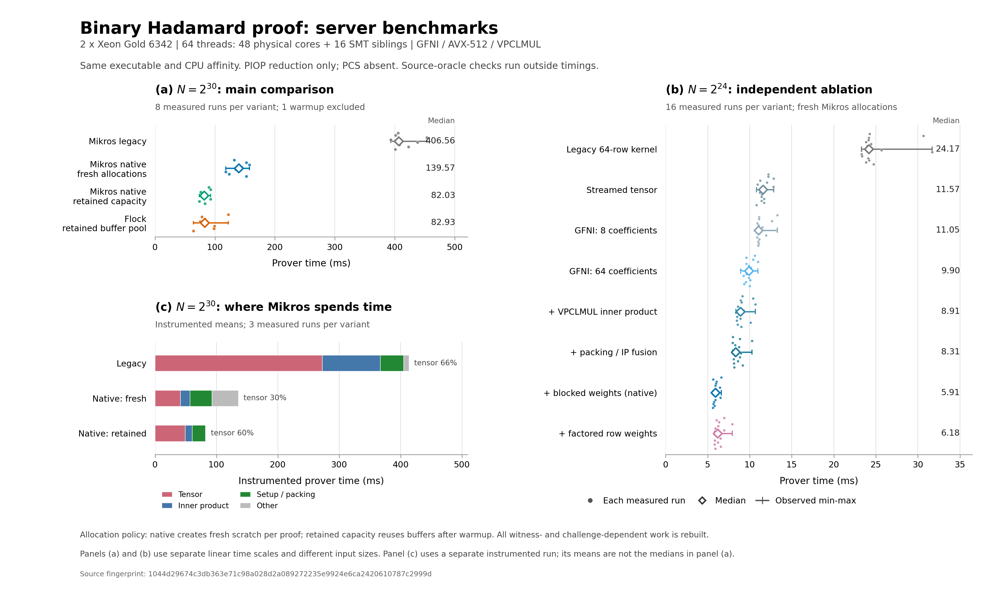

# Binary Mikros：64 线程工程优化与 Flock

v3 同一 binary、N=2^30、64 线程下，warm prover 中位数为：legacy 406.563 ms、native 139.567 ms、reuse 82.032 ms、Flock 82.933 ms。native/Flock 耗时比为 1.68，reuse/Flock 为 0.989；相对 legacy 的工程加速分别为 2.91× 和 4.96×。

主组八次观测中，reuse 与 Flock 基本持平。reuse 的样本范围为 73.7–92.6 ms，Flock 为 64.1–122.2 ms；两者中位数差为 0.901 ms（约 1.09%）。中位数差远小于各自观测范围的宽度，不能据此称为稳定胜出。

随后独立进行的六次 pooled-candidate 补测中，reuse 中位数为 99.268 ms、factoredreuse 为 93.959 ms，同组 Flock 为 72.690 ms；相对该组 Flock 的耗时比分别为 1.3656 和 1.2926。两种复用路径在这组补测中的中位数均高于 Flock；主组的接近结果不能概括成稳定追平或超越 Flock。

本报告由原始 JSON/log 重新校验生成，共覆盖 578 份 benchmark 已成功执行 verifier、transcript 和全部源输入声明核验的证明记录，含开发阶段、预热、诊断及 RSS。汇总器核对记录与摘要，不重新执行密码学验证。

[结果与瓶颈解释](FINDINGS.md) · [实现说明](../../NATIVE_OPTIMIZATION_NOTES.md) · [矢量图](native64_comparison.svg)

## 环境与测量边界

CPU：Intel(R) Xeon(R) Gold 6342 CPU @ 2.80GHz；linux x86_64；Rust：`rustc 1.96.0-nightly (ac7f9ec7d 2026-03-20); binary: rustc; commit-hash: ac7f9ec7da74d37fd28667c86bf117a39ba5b02a; commit-date: 2026-03-20; host: x86_64-unknown-linux-gnu; release: 1.96.0-nightly; LLVM version: 22.1.0`；native target features：`aes, pclmulqdq, sse4.1, gfni, avx2, avx512f, avx512bw, avx512vbmi, vpclmulqdq`。

固定 CPU 集合 `0-47,48-55,72-79`，两个 NUMA 节点各 32 个逻辑 CPU，总计 48 个物理核和 16 个额外 SMT sibling。tests/build/benchmark 的 taskset 命令、全局 Rayon 与 Flock 的 64 线程配置已核对。共享服务器未独占 CPU；不显式绑定或交错 NUMA 内存，采用默认 first-touch。cgroup、load average 和命令起止记录保留在各版本原始环境中。

Mikros 各工程变体使用相同协议、参数和逐字节 proof digest；不同版本源码 fingerprint 分开保存。Flock 使用原生产 degree-two zerocheck，协议和参数不同。双方使用 F128、BLAKE3、关闭 grinding；范围是 PIOP reduction，不含 packed-opening reduction、PCS commitment/opening，不声称相同的 128-bit soundness。

主计时包含每份证明的分配、动态构表、witness 变换、权重、折叠、transcript 和声明构造；不扣除 setup。native/factored 在同一个已预热的进程中每次新建 scratch，此处的 fresh allocation 不等于新进程冷启动。输入生成/digest、challenger 初始化、序列化与全部源输入 oracle 在 prove/verify 计时外，但仍逐份执行。reuse/factoredreuse 各自保留独立 scratch 容量，所有挑战相关内容重算；Flock 保留其生产 pool 复用。factored/factoredreuse 使用分层权重分支，native/reuse 使用完整 row-weight 路径；正式表明确实际测量的名称。

Flock 的 [scratch.rs](../../../crates/flock-core/src/scratch.rs#L37) 使用进程全局 F128 缓冲池，take 优先取得容量足够的旧缓冲；[zerocheck.rs](../../../crates/flock-core/src/zerocheck.rs#L1239) 在结束时用 give_f128 归还四个尾部缓冲，供后续证明复用。因此，在保留容量策略上，reuse 是与生产 Flock 更对称的对照；native 同时展示每次新建并销毁临时 scratch 的 API 成本。两种 Mikros 模式每次都重建挑战相关内容、产生相同消息，并在 prove 之后执行相同的 verifier、transcript 与全部源输入声明检查。

每系统一次预热、八次正式样本。轮换和反序排列使每系统在四个位置各出现两次。保留全部 min/max，不删除慢样本；八次观察不构成统计显著性保证。64 线程跨 NUMA 并使用部分 SMT，不能把它与旧单 NUMA 的 24 线程结果之比解释为只改变线程数的扩展效率。

## 正式 N30 warm prover

单位 ms；legacy/本项为工程加速，Flock/本项大于 1 表示本项更快。

| 系统 | 中位数 | min–max | legacy/本项 | Flock/本项 | 首次预热 prove |
| --- | ---: | ---: | ---: | ---: | ---: |
| legacy | 406.563 | 393.299–453.315 | 1.00× | 0.20 | 408.211 |
| native | 139.567 | 117.995–157.682 | 2.91× | 0.59 | 132.435 |
| reuse | 82.032 | 73.715–92.635 | 4.96× | 1.01 | 83.355 |
| flock | 82.933 | 64.095–122.182 | 4.90× | 1.00 | 105.991 |

首次预热是该变体在配对进程内的第一次证明，保留首次构表/分配成本；进程和其他变体可能已经预热，因此不能称为独立冷启动。下表的 RSS 过程才是全新进程中的单次冷证明。

## Verifier、通信、独立冷进程 RSS 和外部检查

| 系统 | verify 中位数 ms | bincode bytes | 冷 prove ms | 冷前 RSS MiB | 冷峰值 RSS MiB | 源检查中位数 ms | 源检查 min–max ms |
| --- | ---: | ---: | ---: | ---: | ---: | ---: | ---: |
| legacy | 0.1499 | 35,800 | 432.467 | 390.23 | 887.25 | 13,513.342 | 13,459.832–13,710.851 |
| native | 0.1630 | 35,800 | 126.067 | 390.21 | 888.00 | 13,485.935 | 13,467.937–13,588.583 |
| reuse | 0.1948 | 35,800 | 81.712 | 390.23 | 908.20 | 13,507.944 | 13,416.017–13,592.882 |
| flock | 0.3188 | 2,896 | 99.177 | 390.22 | 1,162.21 | 9,094.717 | 9,074.050–9,417.686 |

RSS 的 VmHWM 在 prove 返回后、verify/源输入核验前读取，包含输入、runtime、线程、表和工作区，不是纯算法工作区。独立 RSS 冷时间只作补充，不混入 warm 中位数。冷过程中的 reuse 同样从空容量开始，但在 prove 返回后继续持有 scratch；native 在计时结束前销毁其临时 scratch，Flock 则已将缓冲归还持久池。因此不同冷 API 的容量释放边界仍有所区别。所有冷过程的 source-check 时间及完整进程 wall time 也保存在 summary.csv。

## 独立阶段诊断

以下采用独立 profile 的正式样本均值以保留可加性，不混入无探针主表。Mikros 的 A/B binding 已含 B 权重；fused/native/reuse/factored/factoredreuse 还把 IP 首轮消息并入 binding，因此各阶段的职责有所变化。分层权重也会改变 setup 与使用权重阶段的职责。聚合阶段只表示整个 tensor aggregate，不能直接解释成某条内部指令成本。

| 组别 | N | 系统 | 样本数 | 总均值 ms | setup | tensor | C 投影 | A/B+权重 | IP | 其他/剩余 |
| --- | ---: | --- | ---: | ---: | ---: | ---: | ---: | ---: | ---: | ---: |
| ablation | 2^24 | legacy | 3 | 24.148 | 3.568 | 15.469 | 0.548 | 1.148 | 3.214 | 0.200 |
| ablation | 2^24 | stream | 3 | 11.024 | 3.480 | 3.137 | 0.282 | 1.086 | 2.934 | 0.104 |
| ablation | 2^24 | simdv1 | 3 | 11.112 | 3.457 | 2.999 | 0.571 | 1.132 | 2.771 | 0.182 |
| ablation | 2^24 | simd | 3 | 9.668 | 3.688 | 1.516 | 0.357 | 1.116 | 2.884 | 0.107 |
| ablation | 2^24 | wide | 3 | 8.460 | 3.531 | 1.392 | 0.345 | 1.093 | 1.482 | 0.617 |
| ablation | 2^24 | fused | 3 | 8.331 | 3.469 | 1.496 | 0.384 | 1.080 | 1.316 | 0.586 |
| ablation | 2^24 | native | 3 | 5.665 | 1.066 | 1.370 | 0.243 | 1.078 | 1.319 | 0.589 |
| ablation | 2^24 | factored | 3 | 6.066 | 1.086 | 1.629 | 0.388 | 1.115 | 1.240 | 0.608 |
| candidate | 2^30 | native | 3 | 153.827 | 13.186 | 45.705 | 3.544 | 22.236 | 17.197 | 51.958 |
| candidate | 2^30 | factored | 3 | 141.672 | 11.346 | 42.323 | 3.751 | 18.265 | 15.998 | 49.989 |
| results | 2^30 | legacy | 3 | 413.902 | 21.026 | 272.567 | 4.700 | 12.306 | 94.561 | 8.743 |
| results | 2^30 | native | 3 | 135.893 | 12.299 | 41.375 | 4.533 | 19.009 | 15.591 | 43.086 |
| results | 2^30 | reuse | 3 | 82.643 | 3.159 | 49.244 | 6.142 | 12.288 | 11.619 | 0.190 |

| 组别 | N | Flock 总均值 ms | round1 URM | round2 fused fold | rounds 3+ | 剩余 |
| --- | ---: | ---: | ---: | ---: | ---: | ---: |
| candidate | 2^30 | 127.075 | 27.590 | 59.317 | 39.923 | 0.245 |
| results | 2^30 | 106.356 | 30.183 | 29.393 | 46.513 | 0.266 |

Flock 阶段从服务器本地原始 log 与对应 N/run 逐条连接，打印精度为 0.01 ms，最多允许 0.016 ms 的合计舍入误差。剩余项包含未覆盖工作与计时/日志开销；profile 的三次样本不保证执行位置均衡。

## 同版本逐项消融

legacy→stream→simd→wide→fused→native 为累加工程路径：流式 tensor、GFNI 聚合、四路 VPCLMUL IP、packing/首轮消息与 C 投影融合、row-weight 构建。simdv1 是早期 GFNI 候选；factored 是分层权重的独立分支，不应擅自纳入上述累加链。native→reuse、factored→factoredreuse 分别只改变各自 scratch 容量生命周期。具体路径以本版本 benchmark 的 native_ablation_variants 元数据及源码为准，不能从对 legacy 的总比值推断单项净贡献。

| N | 系统 | 正式样本 | prove 中位数 ms | min–max ms | legacy/本项 | verify ms | bytes |
| ---: | --- | ---: | ---: | ---: | ---: | ---: | ---: |
| 2^24 | legacy | 16 | 24.173 | 23.287–31.679 | 1.00× | 0.1229 | 35,608 |
| 2^24 | stream | 16 | 11.572 | 10.817–12.858 | 2.09× | 0.1206 | 35,608 |
| 2^24 | simdv1 | 16 | 11.053 | 10.865–13.283 | 2.19× | 0.1216 | 35,608 |
| 2^24 | simd | 16 | 9.905 | 8.941–10.966 | 2.44× | 0.1211 | 35,608 |
| 2^24 | wide | 16 | 8.913 | 8.353–10.678 | 2.71× | 0.1219 | 35,608 |
| 2^24 | fused | 16 | 8.312 | 7.965–10.268 | 2.91× | 0.1213 | 35,608 |
| 2^24 | native | 16 | 5.911 | 5.608–6.636 | 4.09× | 0.1216 | 35,608 |
| 2^24 | factored | 16 | 6.182 | 5.834–7.921 | 3.91× | 0.1210 | 35,608 |

### 独立候选比较

本轮 candidate 在主测量完成后串行执行，补充评估 native/factored 的每次分配路径；随后 pooled-candidate 比较 reuse/factoredreuse 的保留容量路径。两组均包含各自 Flock 对照，不用于预选本轮正式路径，也不将候选样本并入 results 中位数。各组只使用本组的 legacy/Flock 计算比值；不存在的基线留空。pooled-candidate 不启用 phase profile。有限样本及共享服务器环境仍限制结果的精度，不构成统计显著性保证。

| 组别 | N | 系统 | 样本数 | prove 中位数 ms | min–max ms | legacy/本项 | Flock/本项 |
| --- | ---: | --- | ---: | ---: | ---: | ---: | ---: |
| candidate | 2^30 | native | 6 | 157.061 | 139.698–169.115 |  | 0.49 |
| candidate | 2^30 | factored | 6 | 139.435 | 124.860–151.543 |  | 0.55 |
| candidate | 2^30 | flock | 6 | 77.139 | 66.180–123.102 |  | 1.00 |
| pooled-candidate | 2^30 | reuse | 6 | 99.268 | 81.418–120.683 |  | 0.73 |
| pooled-candidate | 2^30 | factoredreuse | 6 | 93.959 | 86.422–104.348 |  | 0.77 |
| pooled-candidate | 2^30 | flock | 6 | 72.690 | 69.052–132.105 |  | 1.00 |

消融使用自己的无探针均衡主样本。小尺寸收益不能直接外推到 N30；所有变体的首次预热、独立 RSS、source-check 与 profile 均值在 summary.csv 中单列。

## 开发过程记录

以下各版本和先导运行具有各自 source fingerprint，不合并样本、不替换正式结果，也不据跨版本的非配对时间推断单项收益。独立 baseline/pilot 若没有 driver status/commands/environment，只验证其 JSON、原始阶段日志和摘要，不能声称本地已复核其 CPU affinity 或完整构建执行凭据。

| 版本 | 文件 | 模式 | N | 系统 | 正式样本 | prove 中位数 ms | min–max ms |
| --- | --- | --- | ---: | --- | ---: | ---: | ---: |
| v1 | [v1/results/comparison-64t.json](v1/results/comparison-64t.json) | main | 2^24 | legacy | 8 | 24.031 | 23.309–32.687 |
| v1 | [v1/results/comparison-64t.json](v1/results/comparison-64t.json) | main | 2^24 | stream | 8 | 11.203 | 10.716–14.385 |
| v1 | [v1/results/comparison-64t.json](v1/results/comparison-64t.json) | main | 2^24 | simd | 8 | 11.124 | 10.546–13.026 |
| v1 | [v1/results/comparison-64t.json](v1/results/comparison-64t.json) | main | 2^24 | native | 8 | 9.152 | 8.962–10.180 |
| v1 | [v1/results/profile-64t.json](v1/results/profile-64t.json) | profile | 2^24 | legacy | 3 | 24.252 | 24.044–24.343 |
| v1 | [v1/results/profile-64t.json](v1/results/profile-64t.json) | profile | 2^24 | stream | 3 | 11.159 | 11.000–12.959 |
| v1 | [v1/results/profile-64t.json](v1/results/profile-64t.json) | profile | 2^24 | simd | 3 | 11.972 | 11.320–12.562 |
| v1 | [v1/results/profile-64t.json](v1/results/profile-64t.json) | profile | 2^24 | native | 3 | 9.827 | 8.735–10.453 |
| v1 | [v1/pilot-n30.json](v1/pilot-n30.json) | pilot_profile | 2^30 | legacy | 1 | 425.264 | 425.264–425.264 |
| v1 | [v1/pilot-n30.json](v1/pilot-n30.json) | pilot_profile | 2^30 | simd | 1 | 261.919 | 261.919–261.919 |
| v1 | [v1/pilot-n30.json](v1/pilot-n30.json) | pilot_profile | 2^30 | native | 1 | 354.472 | 354.472–354.472 |
| v1 | [v1/pilot-n30.json](v1/pilot-n30.json) | pilot_profile | 2^30 | reuse | 1 | 128.239 | 128.239–128.239 |
| v1 | [v1/pilot-n30.json](v1/pilot-n30.json) | pilot_profile | 2^30 | flock | 1 | 124.932 | 124.932–124.932 |
| v2 | [v2/results/comparison-64t.json](v2/results/comparison-64t.json) | main | 2^24 | legacy | 8 | 24.952 | 23.001–29.958 |
| v2 | [v2/results/comparison-64t.json](v2/results/comparison-64t.json) | main | 2^24 | stream | 8 | 11.585 | 10.983–14.431 |
| v2 | [v2/results/comparison-64t.json](v2/results/comparison-64t.json) | main | 2^24 | simdv1 | 8 | 11.042 | 10.953–11.502 |
| v2 | [v2/results/comparison-64t.json](v2/results/comparison-64t.json) | main | 2^24 | simd | 8 | 10.036 | 9.507–10.859 |
| v2 | [v2/results/profile-64t.json](v2/results/profile-64t.json) | profile | 2^24 | legacy | 3 | 24.834 | 24.522–27.702 |
| v2 | [v2/results/profile-64t.json](v2/results/profile-64t.json) | profile | 2^24 | stream | 3 | 12.013 | 11.277–12.709 |
| v2 | [v2/results/profile-64t.json](v2/results/profile-64t.json) | profile | 2^24 | simdv1 | 3 | 11.504 | 11.176–12.073 |
| v2 | [v2/results/profile-64t.json](v2/results/profile-64t.json) | profile | 2^24 | simd | 3 | 9.676 | 9.507–10.596 |
| v2 | [v2/pilot-n30.json](v2/pilot-n30.json) | pilot_profile | 2^30 | native | 1 | 319.975 | 319.975–319.975 |
| v2 | [v2/pilot-n30.json](v2/pilot-n30.json) | pilot_profile | 2^30 | reuse | 1 | 110.133 | 110.133–110.133 |
| v2 | [v2/pilot-n30.json](v2/pilot-n30.json) | pilot_profile | 2^30 | flock | 1 | 143.927 | 143.927–143.927 |
| baseline | [baseline/profile-64t.json](baseline/profile-64t.json) | pilot_profile | 2^24 | packed | 3 | 23.531 | 23.069–23.619 |
| baseline | [baseline/profile-64t.json](baseline/profile-64t.json) | pilot_profile | 2^24 | flock | 3 | 3.718 | 3.674–6.097 |
| baseline | [baseline/profile-64t.json](baseline/profile-64t.json) | pilot_profile | 2^30 | packed | 3 | 420.158 | 395.527–422.534 |
| baseline | [baseline/profile-64t.json](baseline/profile-64t.json) | pilot_profile | 2^30 | flock | 3 | 80.256 | 80.155–134.563 |

## 来源与验收

| 版本 | 已核验记录数（含预热/RSS） | benchmark source fingerprint |
| --- | ---: | --- |
| v1 | 82 | `48872b97f7e5bdeefeb4261d4024f801086c0b4e0ec7c8ea9c279f6bcf1acb43` |
| v2 | 84 | `8ffd7c29d07672e89acc7ab6cb443558c9c6553c46c8fdc719ed2e405103371e` |
| v3 | 396 | `1044d29674c3db363e71c98a028d2a089272235e9924e6ca2420610787c2999d` |
| baseline | 16 | `8b3e1454063885e319f23b7d51ef16b53619d8c33491aa488967c4f19b168956` |

各 driver 目录均核对 status=complete、报告清单、命令全部零退出、原生 locked/offline tests/build 来源、样本/预热覆盖、均衡主顺序、summary 中位数/min/max、消息尺寸、phase 字段及加和、独立 RSS 模式、各版本本地 source_manifest 与 server_environment 完全一致。跨所有版本核对同 N/run 输入摘要，以及全部 Mikros 内核和 Flock 各自的 proof digest。

这些摘要检查证明已保存的逐字节一致性，不代替完整源码安全审计或 PCS 验证。原始数据和日志与各版本目录一并保留；[summary.csv](summary.csv) 包含全部表格模式和逐阶段均值。
